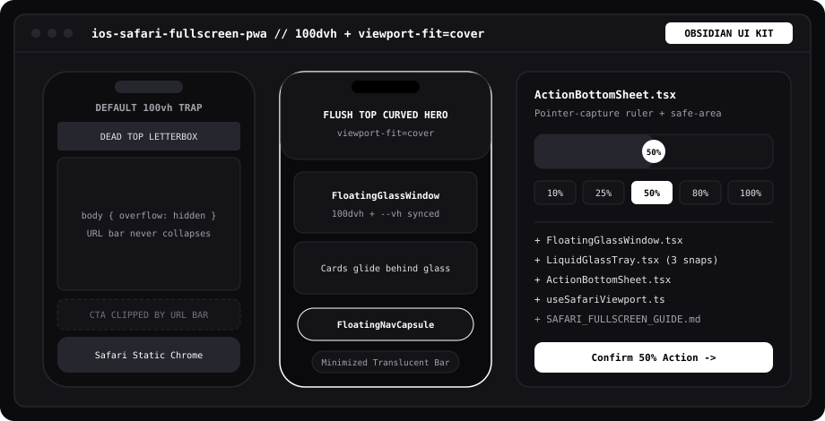

# ios-safari-fullscreen-pwa


safari `100vh` gave me headache for two full nights so i did proper jugaad and fixed it cleanly. on laptop Chrome my app looked super crisp. on a real iPhone the bottom button hid under Safari's floating address bar with a weird blank gap near the notch. this repo fixes all of that out of the box.



## what is this

this is a ready to run React and Vite mobile layout kit for iPhone Safari and Home Screen PWAs.

* it removes top notch gaps and bottom white bars using `viewport-fit=cover` and `100dvh`.
* it keeps natural `body` scroll working so Safari shrinks its URL bar when you swipe down.
* it includes a live button to switch between broken `100vh` mode and fixed fullscreen mode.
* it packs reusable dark obsidian components: `FloatingGlassWindow`, `LiquidGlassTray`, `ActionBottomSheet`, and `FloatingNavCapsule`.
* read [docs/SAFARI_FULLSCREEN_GUIDE.md](./docs/SAFARI_FULLSCREEN_GUIDE.md) if you want to copy the CSS into your own project.

## copy and run in 60 sec

```bash
git clone https://github.com/LevCodeLab/ios-safari-fullscreen-pwa.git
cd ios-safari-fullscreen-pwa
npm install
npm run dev
```

open the local network link on your iPhone in Safari to feel the real scroll. you can also run tests and build:

```bash
npm test
npm run build
```

## how to edit files

no complex CSS frameworks here, just clean files you can edit in 10 seconds.

* `index.html`: edit `<meta name="theme-color">` and app title for your own PWA.
* `src/styles/safari-fullscreen.css`: edit safe area bottom padding, dark obsidian colors, and blur styles here.
* `src/hooks/useSafariViewport.ts`: edit `--vh` height sync and bottom clearance math here.
* `src/components/ActionBottomSheet.tsx`: edit the drag percentage slider and `10%` to `100%` preset buttons here.
* `src/components/LiquidGlassTray.tsx`: edit the 3 step bottom drawer (`collapsed`, `half`, `expanded`) here.
* `src/components/FloatingGlassWindow.tsx`: edit the main hero card text and buttons here.

## license

MIT. see [LICENSE](./LICENSE).
